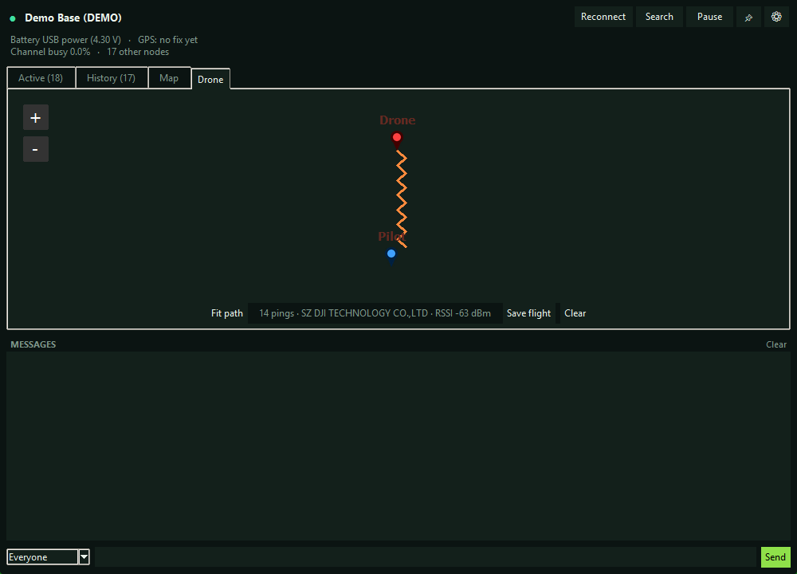
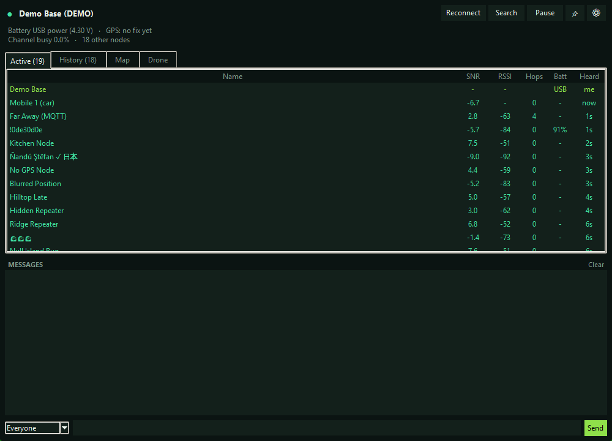

# Central Finite Curve

**A desktop dashboard for a Meshtastic mesh, with live drone Remote ID tracking.**
Created by **DaGromflomite**.

Central Finite Curve connects to a Meshtastic radio over USB or TCP and shows you the mesh at a
glance: the nodes your radio hears, where they sit on a live map, and the messages passing through.
When a Remote ID drone detector is on the mesh, it also turns those alerts into a live flight path
and identifies the drone's manufacturer from its MAC address.

> **Alpha, and Windows-first.** This is early software under active development. Windows is the
> platform it is built and tested on, and the Releases page carries a ready-to-run Windows
> installer. **macOS is not ready yet:** the code is cross-platform and should run from source, but
> it has never been launched on a Mac, so treat the macOS build as an untested, pre-alpha backup.
> There is no prebuilt macOS app at this stage.
>
> Central Finite Curve is free and open source under the GPL-3.0, and it is never for sale.

---

## Screenshots

**Drone tracking** — each Remote ID ping from the detector is plotted and joined into the drone's
flight path, alongside the pilot's location and the manufacturer resolved from the MAC:



**Live mesh** — every node the radio hears, with signal, hops, battery and when it was last heard:



*(Screenshots use the built-in demo data at a neutral location.)*

---

## How it works

- Connect a **Meshtastic radio** (for example a Heltec V3) to your PC over USB. Central Finite Curve
  talks to it through the Meshtastic Python API and listens to every channel you are on.
- The nodes it hears appear in the **Active** and **History** tables and on the **Map**, updated
  live as packets arrive.
- For drone tracking, a **Remote ID detector** on the mesh — such as Colonel Panic's
  [Mesh-Detect](https://github.com/colonelpanichacks/mesh-detect) — picks up nearby drone
  broadcasts and sends one text alert per ping, carrying the drone's GPS, the pilot's GPS, the
  drone's MAC and the signal strength. Central Finite Curve reads those alerts, draws the drone's
  path on the **Drone** tab, marks the pilot, and looks up the manufacturer from the MAC's first
  three octets using the bundled IEEE registry.
- Optionally, alerts can be forwarded to your phone through [ntfy](https://ntfy.sh).

## Features

- **Live node dashboard** — Active and History tables showing SNR, RSSI, hops, battery and last
  heard.
- **Map** — your radio's nodes and, if you want them, internet nodes from meshmap.net, in dark or
  satellite styles, with a tile engine that is easy on memory and data and sleeps when off-screen.
- **Drone tab** — live flight-path tracking from Remote ID alerts: the drone's path, a pilot
  marker, the manufacturer resolved from the MAC, and a running "pings · manufacturer · RSSI"
  readout.
- **Save flight** — export the current track to `flights/flight-<time>.csv` (time, drone GPS, RSSI,
  MAC, manufacturer and pilot GPS), together with a PNG snapshot of the map.
- **Spots nodes passing through** — every few minutes it checks for radios that have come into range
  and nudges them to check in, so a node moving through the area shows up on its own, without anyone
  clicking. It only reaches radios right next to you, not the wider mesh, so it never adds to everyone
  else's traffic. Change how often it runs, or turn it off, in Settings. The **Search** button does a
  bigger sweep whenever you want one.
- **Messaging** — send and receive mesh text, with delivery reports.
- **Phone push** (optional) — forward alerts to your phone through ntfy.
- Runs minimised to the **system tray**, allows only a single instance, and recovers cleanly when a
  radio is unplugged and plugged back in.

## Installing

**Windows:** download the installer from the [Releases](../../releases) page and run it. A portable
zip is there too if you would rather not install. Neither needs Python.

**From source** (Windows, or macOS at your own risk):

```bash
# Python 3.10 or newer, with Tkinter.
#   Windows: the python.org installer includes Tkinter.
#   macOS:   use the python.org build, or run: brew install python-tk
pip install -r requirements.txt
python mesh_widget.pyw
```

On first run, open **Settings** (the gear icon) to choose your radio's port and set your home
location. The widget only ever talks to your radio; your location and settings stay on your PC and
are never sent over the mesh.

## Using the Drone tab

1. Make sure your Remote ID detector is powered on and set to the same Meshtastic channel and region
   as your PC's radio. Its alerts arrive as ordinary mesh messages.
2. Open the **Drone** tab. As pings come in, the orange path traces the drone's route, the red
   marker is its latest position, and the blue marker is the pilot.
3. The label shows the total number of pings, the drone's manufacturer, and the latest signal
   strength.
4. **Fit path** frames the whole flight, **Save flight** writes the CSV and a map snapshot to the
   `flights` folder, and **Clear** resets the track.

## Is this a fork?

No. Central Finite Curve is an original, standalone project, not a fork of anything. It is designed
to work alongside third-party detector hardware (see Credits), but it shares no code with it.

## Credits

The full list is in [CREDITS.md](CREDITS.md). In short, Central Finite Curve is built on the
**Meshtastic** project and the wider open-source Python ecosystem (tkintermapview, Pillow, requests,
sounddevice, pystray and PyPubSub), with map tiles from **OpenStreetMap** contributors and **Esri**,
manufacturer data from the **IEEE** OUI registry, and mesh node data from **meshmap.net**. It is
designed to pair with Colonel Panic's **Mesh-Detect** drone detector. Thank you to everyone whose
work it builds on.

## License

**GPL-3.0-or-later.** Copyright © 2026 DaGromflomite.

Central Finite Curve depends on the Meshtastic Python library, which is GPL-3.0, so Central Finite
Curve is GPL-3.0 as well. That keeps it free and open for good: anyone may use, modify and share it,
but forks and derivatives must stay open source under the GPL and must keep this attribution to the
original author. See [LICENSE](LICENSE) for the full text.

## Known issues (alpha)

- Two of the heavier GUI timing tests (`test_demo_session` and `test_busy_city_scale`) are currently
  flaky and under investigation; the core functionality tests pass.
- The map uses online tiles, so keep the providers' terms in mind, along with your data plan on
  cellular connections.
- Tray and sound behaviour varies a little between operating systems.
- macOS is completely unvalidated — it has not been launched on a Mac. Treat the macOS source as a
  pre-alpha backup, not a working build.
